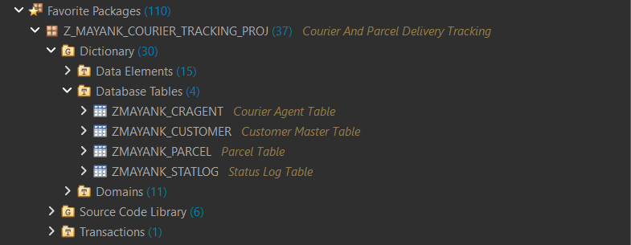
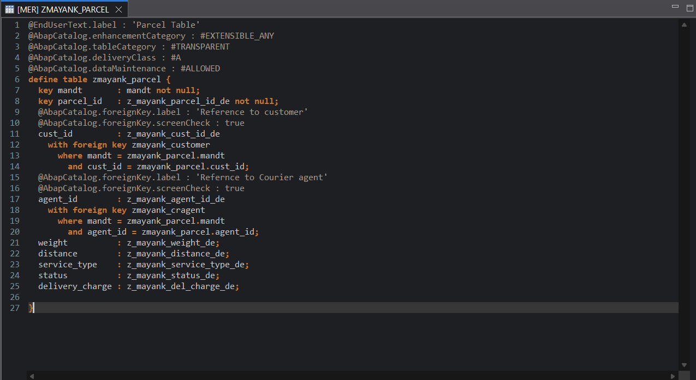
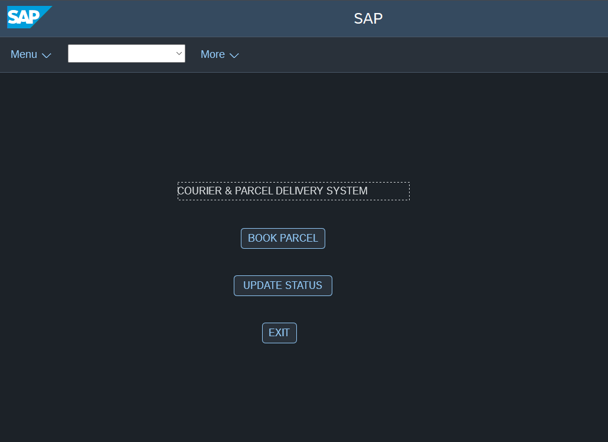
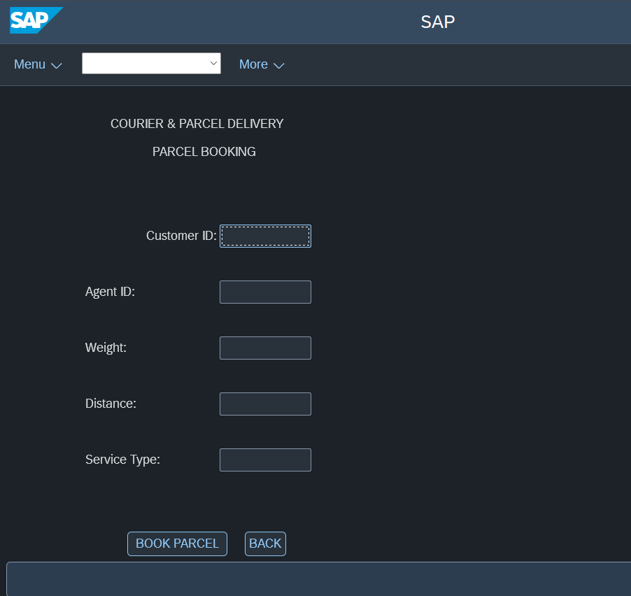
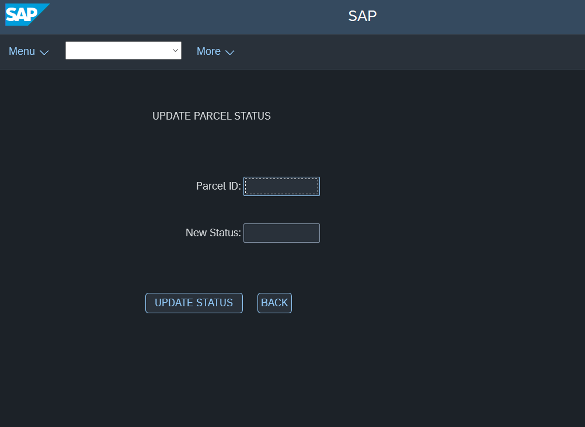
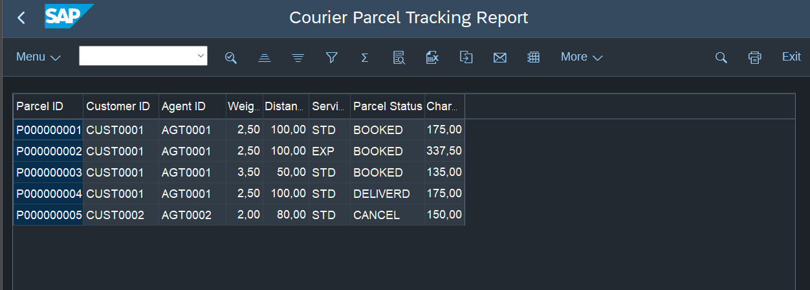
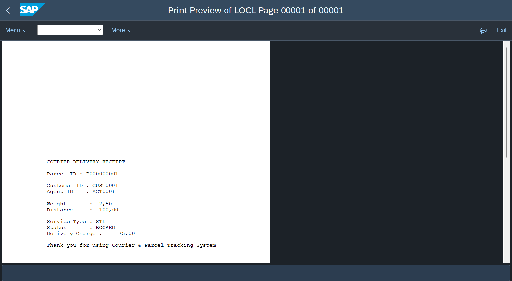

# SAP-Based Courier & Parcel Delivery Tracking System

## Project Overview

The SAP-Based Courier & Parcel Delivery Tracking System is a Classical ABAP project developed to manage courier and parcel information and track delivery status.

The project uses SAP ABAP and the ABAP Dictionary to organize data, process user inputs, display reports, and generate courier-related forms.

## Technologies Used

- SAP ABAP
- SAP GUI
- Eclipse with ABAP Development Tools (ADT)
- ABAP Dictionary (SE11)
- Module Pool Programming
- ALV Reports
- Smart Forms

## Features Implemented

- Custom database tables for Customer, Courier Agent, Parcel, and Status Log.
- Custom domains and data elements.
- Primary keys, foreign keys, and table relationships.
- Module Pool screens with PBO and PAI processing.
- ALV report for displaying project data.
- Smart Form for courier/parcel labels or receipts.

## Project Package

`Z_MAYANK_COURIER_TRACKING_PROJ`

## Project Status

The Classical ABAP components listed above have been developed as part of the project. Modern ABAP features such as CDS Views, OData services, and SAP Fiori are planned as future enhancements.

## Screenshots

Screenshots of the database tables, application screens, ALV report, and Smart Form will be added to the `Screenshots` folder.

## Author

Mayank Shukla

## Note

This repository documents the project implementation and supporting materials. The SAP system and required development environment may be needed to run the ABAP objects.

## Project Screenshots

### 1. Database Tables

### 2. Parcel Table Structure

### 3. Main Application Screen

### 4. Parcel Booking Screen

### 5. Update Parcel Status

### 6. ALV Parcel Tracking Report

### 7. Generated Courier Receipt

